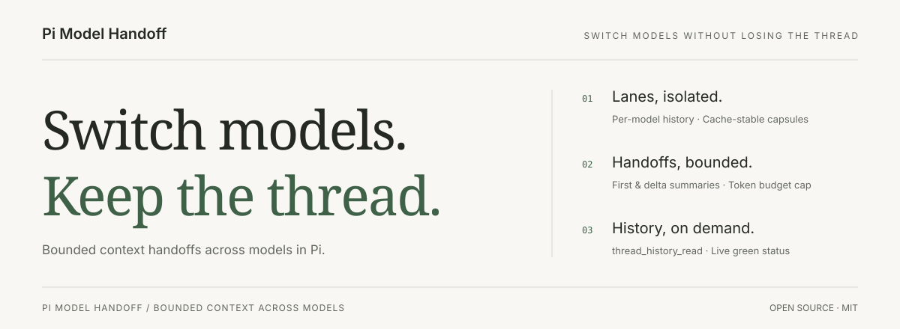

[中文](https://github.com/eachann1024/pi-model-handoff/blob/main/README.zh-CN.md) · [Install](#install) · [Features](#features) · [Reference](#reference)

# Pi Model Handoff

**Switch models. Keep the thread.**

An extension for [Pi](https://pi.dev) that keeps per-model context lanes isolated across mid-session model switches, injects bounded handoff capsules without replaying foreign history, and lets the active model inspect earlier turns on demand.

## Install

```bash
pi install npm:@each1024/pi-model-handoff
```

In an open Pi session, run Pi's built-in `/reload` command. No additional setup is required; handoffs activate automatically when you switch models mid-session.

**Node >= 22.19.0.**

### Update an existing npm installation

```bash
pi update npm:@each1024/pi-model-handoff
```

Then run `/reload` in Pi.

**`pi update` updates Pi itself by default, not its plugins.** Use `pi update --extensions` for all plugins, or `pi update --all` for both. `/reload` reloads files already on disk; it does not download updates.

<details>
<summary>Install from GitHub instead</summary>

```bash
pi install git:github.com/eachann1024/pi-model-handoff
```

</details>

## Features

### 01 / Lanes, isolated

- **Keyed by `provider/id`.** Every model operates in its own context lane (`provider/modelId`). Single-lane threads with no foreign model activity and no frozen handoff records pass through unmodified.
- **Frozen, cache-stable records.** On a cross-model switch, the extension builds a deterministic handoff capsule (with no extra LLM call) and persists it as a `pi-model-handoff:record` entry anchored to `(targetLane, anchorUserEntryId)`. Keeping the first record per anchor preserves the target lane's prompt prefix cache across subsequent turns.
- **Compaction and tree compatible.** Branch projection slices from the latest `compaction` entry (preserving `firstKeptEntryId` entries), and `session_start`, `session_tree`, and `session_compact` clear the in-memory record cache so projections rebuild cleanly from the active branch.

### 02 / Handoffs, bounded

- **Three handoff strategies.**
  - **First handoff (`full_thread_summary`)**: when the target lane has no prior delivered run on the active branch, summarizes earlier runs (including pre-run `compaction` / `branch_summary` context) and omits foreign native turns.
  - **Delta handoff (`delta_since_target_last_seen`)**: when the target lane already delivered a run on the active branch, retains the target lane's native prefix and summarizes only turns produced after that run.
  - **Fallback reset (`fallbackReset`)**: when remaining budget for a delta handoff drops below `512` bytes, resets to a fresh `full_thread_summary` anchored to the current turn and drops earlier native runs so the prompt still fits (or drops earlier runs with no capsule if available budget is `0` bytes).
- **Configurable token cap.** `PI_MODEL_HANDOFF_TOKEN_CAP` sets the maximum token budget per capsule (default `16000`, clamped to `1024–64000`). The budget planner reserves workspace tokens, system overhead, native prefix tokens, and current turn input before sizing the capsule.

### 03 / History, on demand

- **`thread_history_read` tool.** Read-only tool registered for the active model. Handoff capsules list omitted `entryId`s and direct the model to inspect omitted or truncated entries with `thread_history_read` instead of guessing.
- **`/handoff-status [on|off|bypass]` command.** Displays the active lane, token cap, run count, latest/pending handoff, and remaining context; `off` pauses handoffs into pass-through mode (`bypass=on`), `on` re-enables handoffs (`bypass=off`), and `bypass` toggles the state.
- **Live green status and widgets.** Renders a green footer status showing the active lane, handoff mode, capsule tokens, and estimated remaining context; displays a one-line preview widget when `model_select` switches lanes, plus an expandable renderer for `pi-model-handoff:record` entries in the transcript.

## Reference

<details>
<summary><strong>Commands &amp; environment variables</strong> — status, bypass, and token cap</summary>

| Item | Default / Arguments | Behavior |
| --- | --- | --- |
| `/handoff-status` | `[status]` | Shows active lane, token cap, run count, target record count, pending/latest handoff, and remaining context |
| `/handoff-status on` | `on` (`bypass off`) | Re-enables model handoff projection (`bypass=off`) and refreshes status/widget |
| `/handoff-status off` | `off` (`bypass on`) | Enables pass-through mode (`bypass=on`), clears pending widget, and keeps native branch messages intact |
| `/handoff-status bypass` | `bypass` (`toggle`) | Toggles bypass mode; `session_start` always resets `bypass` to `false` |
| `PI_MODEL_HANDOFF_TOKEN_CAP` | `16000` (`1024–64000`) | Maximum token budget per handoff capsule; non-numeric or non-positive values fall back to `16000` |

</details>

<details>
<summary><strong><code>thread_history_read</code> parameters</strong> — schema, views, and 30 KB response cap</summary>

| Parameter | Type | Range / Default | Description |
| --- | --- | --- | --- |
| `entryId` | `string` | optional | Inspect a specific session entry by id (ignores `view`, `beforePosition`, and `afterPosition`) |
| `textOffset` | `integer` | `>= 0`, default `0` | Character offset when paging through a long entry selected by `entryId` |
| `view` | `"messages" \| "activity"` | default `"messages"` | `"messages"` returns `user_message`, `assistant_message`, `custom_message`, `compaction`, and `branch_summary`; `"activity"` also includes `tool_result` and `bash_execution` |
| `beforePosition` | `integer` | `>= 0` | Return entries strictly before this 0-based timeline position |
| `afterPosition` | `integer` | `>= 0` | Return entries strictly after this 0-based timeline position |
| `limit` | `integer` | `1–50`, default `10` | Maximum items returned per page |
| `maxCharsPerItem` | `integer` | `200–20000`, default `4000` | Maximum characters per returned item |

- **30 KB response cap (`30,000` bytes).** Both formatted output and JSON payload are enforced within `30,000` UTF-8 bytes (`THREAD_READ_RESULT_MAX_BYTES`). Overflow items are dropped first while retaining at least one item; if a single item still exceeds the limit, its text is truncated safely at UTF-16 boundaries with `textTruncated=true` and `nextTextOffset` for continuation.

</details>

<details>
<summary><strong>How handoffs &amp; budgets work</strong> — extraction, anchor priority, and budget math</summary>

- **Deterministic extraction (no LLM calls).** Extracts `user_message`, `assistant_message` text, successful `edit`/`write` file changes, `bash` commands and outputs (command capped at `300` chars, output at `1,200` chars), tool/assistant errors and aborts (capped at `1,200` chars), `compaction_summary`, `branch_summary`, and `custom_message` (excluding `pi-model-handoff:record`). Thinking blocks and successful `read`/`grep`/`find`/`ls` outputs are omitted from capsules and remain readable via `thread_history_read`.
- **Image &amp; attachment handling.** Historical images are not replayed inside capsules and appear as `[image attachment not replayed]`. Current-turn attachments count toward the input reserve at `8,192` tokens per image and `4,096` tokens per other attachment.
- **Anchor priority &amp; backfill.** After reserving the header and up to `1/8` of the capsule budget for omitted `entryId`s (at most `20` listed IDs), items are selected in priority order: **last user message → last assistant message → first user message**, then reverse chronological backfill, and rendered in chronological order. Anchors may be truncated (down to `160` bytes available) with a `thread_history_read` pointer instead of being dropped first.
- **Budget &amp; reserves.** Text tokens are estimated as `ceil(UTF-8 bytes / 4)`. Using the model's `contextWindow` (default `128,000` when missing), the planner reserves `workReserveTokens` (`clamp(ceil(window / 4), 16000, ceil(window / 2))`) and `systemOverheadTokens` (`min(2000, floor(window * 0.1))`), subtracts `nativeTokens` (delta mode) and `currentTokens`, and sets `budgetBytes = min(tokenCap, availableTokens) * 4` (capped at `tokenCap * 4` and `256,000` bytes). Delta budgets below `512` bytes trigger `fallbackReset`.
- **Message sequence safety.** Orphaned `toolResult` messages whose matching `toolCall` was omitted are stripped during projection so provider message invariants hold.

</details>

<details>
<summary><strong>Development</strong> — local setup, checks, and source layout</summary>

Install only the local copy while developing; installing npm and local copies together double-registers the extension:

```bash
pi remove npm:@each1024/pi-model-handoff && pi install /path/to/pi-model-handoff
npm run check
```

Run `/reload` in an open Pi session after source changes. `npm run check` runs `tsc --noEmit` across `src/**/*.ts` with `strict`, `noUnusedLocals`, and `noUnusedParameters` enabled.

| File | Responsibility |
| --- | --- |
| [`src/index.ts`](src/index.ts) | Extension entry, Pi lifecycle hooks, `thread_history_read` registration, `/handoff-status` command |
| [`src/lane-projection.ts`](src/lane-projection.ts) | Compaction slicing, run segmentation, frozen record collection, delta/full/fallback projection and preview |
| [`src/handoff-budget.ts`](src/handoff-budget.ts) | `PI_MODEL_HANDOFF_TOKEN_CAP` resolution, budget math, item extraction, anchor selection and rendering |
| [`src/history-read-tool.ts`](src/history-read-tool.ts) | Timeline builder, cursor and `entryId` pagination, `30,000`-byte response limit |
| [`src/ui-feedback.ts`](src/ui-feedback.ts) | Green footer status, pending/fallback widgets, custom entry renderer, status summary formatter |
| [`src/types.ts`](src/types.ts) | Shared constants, limits, and TypeScript interfaces |

</details>

---

[MIT License](LICENSE) · Built for [Pi](https://pi.dev)
