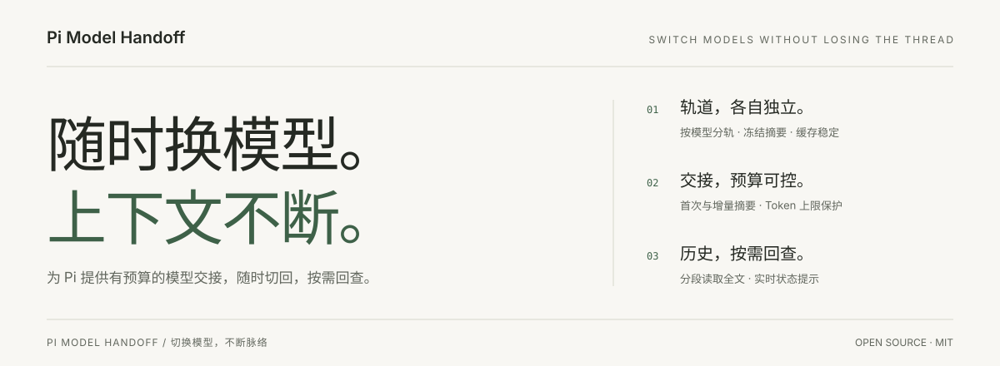

[English](https://github.com/eachann1024/pi-model-handoff/blob/main/README.md) · [安装](#安装) · [功能](#功能) · [参考](#参考)

# Pi Model Handoff

**随时换模型。上下文不断。**

为 [Pi](https://pi.dev) 提供的扩展：在会话中途切换模型时隔离各模型上下文轨道，按预算注入交接摘要而不回放其他模型的冗长历史，并让当前模型按需回查早期对话全文。

## 安装

```bash
pi install npm:@each1024/pi-model-handoff
```

在已打开的 Pi 会话中运行内置的 `/reload` 命令即可生效，无需额外配置；会话中途切换模型时自动接管。

**要求 Node >= 22.19.0。**

### 更新已安装的 npm 版本

```bash
pi update npm:@each1024/pi-model-handoff
```

然后在 Pi 中运行 `/reload`。

**注意：`pi update` 默认只更新 Pi 本体。** 更新全部插件用 `pi update --extensions`，同时更新 Pi 和插件用 `pi update --all`。`/reload` 只重新加载磁盘上的文件，不会下载新版本。

<details>
<summary>也可以从 GitHub 安装</summary>

```bash
pi install git:github.com/eachann1024/pi-model-handoff
```

</details>

## 功能

### 01 / 轨道，各自独立

- **按 `provider/id` 分轨。** 每个模型拥有独立的上下文轨道（`provider/modelId`）。单模型会话在没有其他模型记录和冻结交接记录时直接直通，不修改消息。
- **冻结记录，缓存稳定。** 跨模型切换时，扩展以确定性规则生成交接摘要（不发起额外 LLM 调用），并以自定义条目 `pi-model-handoff:record` 持久化锚定到 `(targetLane, anchorUserEntryId)`。同一锚点始终复用首次生成的冻结记录，保持目标轨道的前缀提示词缓存稳定。
- **兼容压缩与分支树。** 分支投影从最近一次 `compaction` 起切片（保留 `firstKeptEntryId` 指定条目）；`session_start`、`session_tree` 与 `session_compact` 会清空内存缓存并基于当前活动分支重新计算。

### 02 / 交接，预算可控

- **三种摘要策略。**
  - **首次摘要（`full_thread_summary`）**：目标轨道在当前活动分支上尚无已完成轮次时，提取此前轮次（含前置 `compaction` / `branch_summary`）生成摘要，并省略其他模型的原生轮次。
  - **增量摘要（`delta_since_target_last_seen`）**：目标轨道此前已有已完成轮次时，保留其原生前缀不变，仅对上次出现之后的新增轮次生成增量摘要。
  - **保底摘要（`fallbackReset`）**：当增量摘要可用预算低于 `512` 字节时，回退为锚定当前轮次的全新 `full_thread_summary` 并丢弃前置原生轮次以保证不超窗；若可用预算为 `0` 字节，则仅丢弃前置轮次而不注入摘要。
- **Token 上限控制。** 通过环境变量 `PI_MODEL_HANDOFF_TOKEN_CAP` 设置单次交接摘要上限（默认 `16000`，范围 `1024–64000`）。预算计算会先扣除工作预留、系统开销、原生前缀与当前输入及附件预估。

### 03 / 历史，按需回查

- **`thread_history_read` 工具。** 向当前模型注册只读历史检索工具。交接摘要会列出被省略的 `entryId`，提示模型在需要细节或遇到截断条目时调用 `thread_history_read` 精确回查，而不是猜测。
- **`/handoff-status [on|off|bypass]` 命令。** 查看当前轨道、摘要上限、轮次计数、最近/待执行接管与剩余上下文；`off` 暂停接管进入直通模式（`bypass=on`），`on` 恢复接管（`bypass=off`），`bypass` 切换开关。
- **绿色状态栏与提示 Widget。** 页脚绿色状态展示当前模型、接管模式、摘要 token 与估算剩余上下文；`model_select` 切换轨道时显示单行预览 Widget，会话记录中的 `pi-model-handoff:record` 支持展开查看纳入与省略条数。

## 参考

<details>
<summary><strong>命令与环境变量</strong> — 状态查询、直通开关与上限配置</summary>

| 名称 | 默认值 / 参数 | 说明 |
| --- | --- | --- |
| `/handoff-status` | `[status]` | 显示当前目标轨道、摘要上限、会话轮次、记录条数、待接管/最近接管与剩余上下文 |
| `/handoff-status on` | `on`（`bypass off`） | 启用模型交接（`bypass=off`）并刷新状态栏与提示 Widget |
| `/handoff-status off` | `off`（`bypass on`） | 暂停交接进入直通模式（`bypass=on`），清除待接管 Widget，原样发送分支消息 |
| `/handoff-status bypass` | `bypass`（`toggle`） | 切换直通状态；`session_start` 会重置 `bypass` 为 `false` |
| `PI_MODEL_HANDOFF_TOKEN_CAP` | `16000`（`1024–64000`） | 单次交接摘要 Token 上限；非数字或非正数时回退到 `16000` |

</details>

<details>
<summary><strong><code>thread_history_read</code> 参数</strong> — 参数表、视图过滤与 30 KB 响应上限</summary>

| 参数 | 类型 | 范围 / 默认值 | 说明 |
| --- | --- | --- | --- |
| `entryId` | `string` | 可选 | 按 ID 精确读取单条会话记录（忽略 `view`、`beforePosition` 与 `afterPosition`） |
| `textOffset` | `integer` | `>= 0`，默认 `0` | 配合 `entryId` 分段读取长条目的字符偏移量 |
| `view` | `"messages" \| "activity"` | 默认 `"messages"` | `"messages"` 返回 `user_message`、`assistant_message`、`custom_message`、`compaction` 与 `branch_summary`；`"activity"` 额外包含 `tool_result` 与 `bash_execution` |
| `beforePosition` | `integer` | `>= 0` | 返回严格早于该 0-based 时间线位置的条目 |
| `afterPosition` | `integer` | `>= 0` | 返回严格晚于该 0-based 时间线位置的条目 |
| `limit` | `integer` | `1–50`，默认 `10` | 每页最多返回的条目数 |
| `maxCharsPerItem` | `integer` | `200–20000`，默认 `4000` | 单条目的最大返回字符数 |

- **30 KB 响应上限（`30,000` 字节）。** 格式化文本与 JSON 载荷同时受 `30,000` UTF-8 字节限制（`THREAD_READ_RESULT_MAX_BYTES`）。超出时先丢弃多余条目（至少保留 1 条）；若单条仍超限，则按 UTF-16 安全边界截断并给出 `textTruncated=true` 与 `nextTextOffset` 供继续翻页。

</details>

<details>
<summary><strong>交接与预算机制</strong> — 确定性提取、锚点优先级与预算计算</summary>

- **确定性提取（无额外 LLM 调用）。** 提取 `user_message`、`assistant_message` 文本、成功的 `edit`/`write` 文件变更、`bash` 命令与输出（命令截断上限 `300` 字符，输出 `1,200` 字符）、工具/助手错误与中断记录（上限 `1,200` 字符）、`compaction_summary`、`branch_summary` 以及 `custom_message`（排除 `pi-model-handoff:record`）。Thinking 块与成功的 `read`/`grep`/`find`/`ls` 输出不内联进摘要，需要时由 `thread_history_read` 回查。
- **图片与附件处理。** 历史消息中的图片不在摘要中重放，统一替换为 `[image attachment not replayed]`。当前轮次附件在输入预留中按每张图片 `8,192` tokens、其他附件 `4,096` tokens 计入。
- **锚点优先级与回填。** 扣除头部说明与省略列表预算（不超过总预算的 `1/8`，最多列出 `20` 个 `entryId`）后，按 **最后一条用户消息 → 最后一条助手消息 → 第一条用户消息** 的锚点优先级选取条目，再从新到旧逆序回填，最后按时间正序输出。预算紧张时允许保留锚点并截断正文（最低保留 `160` 字节），同时附带 `thread_history_read` 调用提示。
- **预算与预留公式。** 文本按 `ceil(UTF-8 字节数 / 4)` 估算 token。基于模型 `contextWindow`（未知时默认 `128,000`），预留 `workReserveTokens`（`clamp(ceil(window / 4), 16000, ceil(window / 2))`）与 `systemOverheadTokens`（`min(2000, floor(window * 0.1))`），扣除增量模式下的 `nativeTokens` 与当前轮次 `currentTokens`，得到 `budgetBytes = min(tokenCap, availableTokens) * 4`（不超过 `tokenCap * 4` 与 `256,000` 字节）。增量预算低于 `512` 字节时触发 `fallbackReset`。
- **工具调用序列安全。** 投影阶段会自动清除失去对应 `toolCall` 的孤立 `toolResult` 消息，确保消息序列符合模型接口要求。

</details>

<details>
<summary><strong>本地开发与检查</strong> — 本地挂载、类型检查与源码结构</summary>

开发时仅保留本地副本；同时安装 npm 版本与本地版本会导致扩展重复注册：

```bash
pi remove npm:@each1024/pi-model-handoff && pi install /path/to/pi-model-handoff
npm run check
```

修改源码后在已打开的 Pi 会话中执行 `/reload`。`npm run check` 会对 `src/**/*.ts` 运行 `tsc --noEmit`（开启 `strict`、`noUnusedLocals` 与 `noUnusedParameters`）。

| 文件 | 职责 |
| --- | --- |
| [`src/index.ts`](src/index.ts) | 扩展入口、Pi 生命周期钩子、`thread_history_read` 注册与 `/handoff-status` 命令 |
| [`src/lane-projection.ts`](src/lane-projection.ts) | 压缩分支切片、轮次切分、冻结记录收集、首次/增量/保底投影与预览 |
| [`src/handoff-budget.ts`](src/handoff-budget.ts) | `PI_MODEL_HANDOFF_TOKEN_CAP` 解析、预算计算、条目提取、锚点选择与渲染 |
| [`src/history-read-tool.ts`](src/history-read-tool.ts) | 时间线构建、游标与 `entryId` 分页、`30,000` 字节上限裁剪 |
| [`src/ui-feedback.ts`](src/ui-feedback.ts) | 页脚绿色状态、待接管/保底 Widget、自定义记录渲染器与状态摘要格式化 |
| [`src/types.ts`](src/types.ts) | 公共常量、阈值与 TypeScript 类型定义 |

</details>

---

[MIT License](LICENSE) · 为 [Pi](https://pi.dev) 打造
